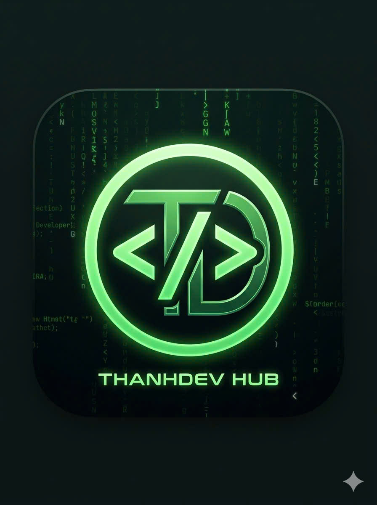

<div align="center">



# ⚡ SOLVER PRO V8

**Hệ sinh thái công cụ đối chiếu & giải bài tập luyện tập trên Windows & Trình duyệt tích hợp Google Gemini API**

[](#)
[](#)
[](#)
[](#)
[](#)

*4 thành phần đồng bộ thương hiệu ThanhDevHub: Trang Web tải xuống • File `.EXE` độc lập • Mã nguồn Python • Extension trình duyệt*

</div>

---

## 📁 Cấu trúc thư mục dự án

```text
📦 SolverProV8/
 ┣ 📜 index.html                         # Trang Web giới thiệu & tải trực tiếp bản cài đặt
 ┣ 🖼️ logo.jpg                           # Logo thương hiệu ThanhDevHub (dùng chung toàn hệ thống)
 ┣ 📂 dist/
 ┃ ┗ 🚀 SolverProV8.exe                  # Bản Desktop chạy ngay (độc lập, không cần cài đặt)
 ┣ 📂 build/                             # Thư mục tạm sinh ra khi đóng gói PyInstaller (có thể xóa)
 ┣ 📜 solver_pro_v8.py                   # Mã nguồn Python gốc của ứng dụng Desktop
 ┣ 📜 SolverProV8.spec                   # File cấu hình đóng gói PyInstaller
 ┣ 📦 SolverProV8_Extension_Flat.zip     # Gói tiện ích mở rộng cho Chrome / Edge / Cốc Cốc
 ┗ 📖 README.md                          # Tài liệu hướng dẫn sử dụng
```

> **Lưu ý vị trí `logo.jpg`:**
> * Đặt **`logo.jpg`** ngang hàng với **`index.html`** và **`solver_pro_v8.py`** để tự động hiển thị trên Web, App Desktop và tự động nhúng vào gói Extension khi tải từ Web.
> * Nếu cài Extension thủ công từ file `.zip` rời, hãy chép thêm **`logo.jpg`** vào cùng thư mục chứa `manifest.json`.

---

## ✨ Tính năng nổi bật

* **🖥️ Chụp vùng màn hình / Tab web trực tiếp:** Kéo chuột khoanh vùng đề bài để AI xử lý ngay (tự động khử lệch tọa độ khi bật Windows Scaling `125%–150%`).
* **📋 Dán thông minh (`Ctrl + V`):** Tự động nhận diện ảnh chụp màn hình từ Clipboard (`Win + Shift + S`) hoặc văn bản để gửi giải ngay trong 1 thao tác.
* **✂️ Cắt vùng & Tải file ảnh:** Hỗ trợ mở file `PNG`, `JPG`, `JPEG`, `WEBP` (tối đa `10 MB`) để khoanh vùng từng câu hỏi hoặc giải toàn bộ ảnh.
* **🤖 Tự động dò tìm & xếp hạng Model:** Tự động quét danh sách model `gemini-*` khả dụng, ưu tiên bản `Flash` / `Lite` ổn định mới nhất và tự chuyển sang model dự phòng nếu gặp lỗi.
* **🔑 Lưu cấu hình tự động:** Ghi nhớ Gemini API Key sau lần kết nối đầu tiên (lưu cục bộ trong `%APPDATA%` với bản Desktop hoặc `chrome.storage.local` với bản Extension).

---

## 🚀 Hướng dẫn sử dụng (3 Cách)

### Cách 1: Chạy trực tiếp bằng file `.EXE` (Windows — Không cần cài Python)

1. Mở thư mục **`dist`** và nhấp đúp vào **`SolverProV8.exe`** (hoặc tải trực tiếp từ trang **`index.html`**).
2. Chờ thanh khởi động chạy hoàn tất **`100%`**, nhấn **`BẮT ĐẦU →`**.
3. Nhấn **`Dán API Key`** (hoặc nhập thủ công) → nhấn **`Kiểm tra & Kết nối`**.

---

### Cách 2: Chạy trực tiếp từ mã nguồn Python & Đóng gói kèm Logo

**Bước 1:** Cài đặt thư viện xử lý ảnh `Pillow` (yêu cầu Python 3.10+):
```bash
pip install pillow
```

**Bước 2:** Đảm bảo có file `logo.jpg` cùng thư mục và khởi chạy ứng dụng:
```bash
python solver_pro_v8.py
```

**Bước 3 (Tùy chọn):** Đóng gói lại thành file `.exe` mới kèm nhúng sẵn `logo.jpg` vào bên trong:
```bash
pip install pyinstaller
pyinstaller --noconsole --onefile --icon=logo.jpg --add-data "logo.jpg;." --name SolverProV8 solver_pro_v8.py
```

---

### Cách 3: Cài đặt Extension trên Trình duyệt (Chrome / Edge / Cốc Cốc)

1. Giải nén file **`SolverProV8_Extension_Flat.zip`** ra thư mục `SolverProV8_Extension_Flat` (chép kèm file **`logo.jpg`** vào thư mục này nếu chưa có).
2. Mở trình duyệt và truy cập **`chrome://extensions`** (hoặc **`edge://extensions`**).
3. Bật công tắc **Developer mode (Chế độ dành cho nhà phát triển)** ở góc trên bên phải.
4. Nhấn **Load unpacked (Tải tiện ích đã giải nén)** → chọn thẳng thư mục **`SolverProV8_Extension_Flat`** chứa file `manifest.json`.
5. Ghim biểu tượng **Solver Pro V8 - ThanhDevHub** lên thanh công cụ và sử dụng.

---

## 🎮 Bảng thao tác & Phím tắt nhanh

| Thao tác / Nút bấm | Bản Desktop (`.exe` / `.py`) | Bản Extension (Trình duyệt) |
| :--- | :--- | :--- |
| **Chụp vùng đề bài** | Bấm **`Chụp vùng màn hình`** → kéo chọn vùng trên màn hình (`Esc` để hủy). | Bấm **`Chụp vùng trên web`** → kéo chọn vùng trên tab web → mở lại popup để xem kết quả. |
| **Dán nhanh (`Ctrl + V`)** | Tự động gửi ảnh chụp từ `Win + Shift + S` hoặc dán chữ vào ô nhập. | Tự động gửi ảnh chụp từ `Win + Shift + S` hoặc dán chữ vào ô nhập. |
| **Giải văn bản** | Nhập/dán đề bài → bấm **`Giải văn bản`**. | Nhập/dán đề bài → bấm **`Giải văn bản`**. |
| **Xử lý file ảnh** | Bấm **`Cắt từ file ảnh`** để khoanh vùng hoặc **`Chọn file ảnh giải ngay`**. | Bấm **`Chọn ảnh`** để tải file ảnh từ máy tính lên. |
| **Tiện ích cửa sổ** | Kéo thanh trượt độ mờ (`75%–100%`), bấm **`Sao chép`** hoặc **`Đổi API`**. | Bấm **`Sao chép`** kết quả hoặc **`Đổi API`** ở thanh dưới cùng. |

---

## 🔑 Lấy & Quản lý Gemini API Key

1. Truy cập **[Google AI Studio](https://aistudio.google.com/)** và đăng nhập tài khoản Google.
2. Chọn **Get API key** → **Create API key** → sao chép chuỗi khóa.
3. Dán vào màn hình kết nối của **Solver Pro V8**.

* **Nơi lưu Key tự động:**
  * Bản Desktop: `%APPDATA%\SolverProV8\config.json`
  * Bản Extension: `chrome.storage.local` của trình duyệt
* **Đổi / Xóa Key:** Bấm **`Đổi API`** ngay trong giao diện để ghi đè key mới bất kỳ lúc nào.

---

## 🛠️ Khắc phục sự cố thường gặp

<details>
<summary><b>1. Windows SmartScreen cảnh báo khi mở <code>SolverProV8.exe</code></b></summary>
<br>
Nhấn <b>More info</b> → chọn <b>Run anyway</b>. Cảnh báo này xuất hiện do file <code>.exe</code> tự đóng gói cá nhân chưa đăng ký chữ ký số thương mại.
</details>

<details>
<summary><b>2. Lỗi <i>"Tệp kê khai bị thiếu hoặc không thể đọc được"</i> hoặc thiếu icon khi cài Extension</b></summary>
<br>
Đảm bảo bạn đã <b>giải nén</b> file <code>.zip</code>, đặt file <code>logo.jpg</code> ngang hàng với <code>manifest.json</code>, và chọn đúng thư mục chứa trực tiếp <code>manifest.json</code> khi bấm <b>Load unpacked</b>.
</details>

<details>
<summary><b>3. Lỗi kết nối API (<code>HTTP 400</code>, <code>403</code>, <code>429</code>)</b></summary>
<br>
<ul>
  <li>Kiểm tra lại kết nối Internet.</li>
  <li>Đảm bảo API Key không dính khoảng trắng thừa và chưa vượt hạn mức miễn phí (Quota) trên Google AI Studio.</li>
</ul>
</details>

---

<div align="center">


**© 2026 ThanhDevHub • All Rights Reserved**

</div>
